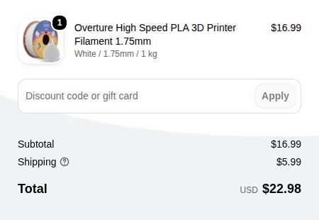

# Bill of materials — single-color PLA baseline

Price checked October 18, 2026 on the official US vendor site and in its cart. USD. This is an unpurchased material plan, not a receipt or reimbursement claim.

| Part | Quantity | Unit price (USD) | Line total (USD) | Vendor | Product |
| --- | ---: | ---: | ---: | --- | --- |
| Overture High Speed PLA, White, 1.75 mm, 1 kg spool | 1 | $16.99 | $16.99 | Overture 3D | [Exact selected variant](https://overture3d.com/products/overture-pla?variant=42105033359614) |
| **Material subtotal** | | | **$16.99** | | |

For a contiguous-US delivery, the vendor publishes a $5.99 flat shipping rate on orders below $29.99. That gives a **$22.98 pre-tax budget** ($16.99 materials + $5.99 shipping). The subsequent checkout confirmation is recorded below. This shipping allowance is based on the published policy, not an address-specific checkout quote. The cart showed one white 1 kg spool and a $16.99 merchandise total before shipping/tax. No purchase was completed.

[Official US shipping policy](https://overture3d.com/pages/shipping-policy-us), checked October 18, 2026. This vendor ships only to the contiguous US; if the delivery destination differs, choose another vendor and reprice the BOM.

## What the filament covers

Print one chassis, funnel, cascade, approach bridge, collector ramp, selector, cup, regular ballast carrier, endclip, axle, and nominal 8 mm marble, plus two retainers. Print the coupon first. `ballast-light` is an optional replacement for the regular carrier; do not install both. The purchased spool quantity is not a measured project-consumption estimate. Confirm slicer consumption including supports and failed-print allowance before relying on the spool count.

The assembly guide permits a measured straight 18.8 mm piece of nominal 1.75 mm filament as an alternative axle, so no separate metal axle is included. The baseline specifies no purchased motors, bearings, magnets, screws, electronics, or steel marble. Existing printer and tools are excluded from this parts BOM.

The material choice is the documented PLA baseline. It assumes a printer that accepts 1.75 mm PLA; no printer-specific profile is supplied. A small removable tape tab is an optional retention aid if the counterweight clip is loose, not a specified purchased assembly component.

## Color and scope

One white spool is a functional single-color baseline. The renders illustrate possible finishes, not mandatory multi-color purchases. No paint, decorative finishes, or printer is included.

## Source

[Official Overture product page](https://overture3d.com/products/overture-pla?variant=42105033359614). Cart and product price observed October 18, 2026: White / 1.75mm / 1 kg, quantity 1, $16.99. Recheck price and stock before ordering.

## Checkout confirmation — October 18, 2026

The live saved checkout session quoted **$22.98 total**: $16.99 for one white 1 kg spool plus $5.99 standard shipping. No separate sales-tax line was displayed. This confirms the total shown for that session, without assuming that tax is universally zero or that another delivery address will have the same quote. No order was placed.

The screenshot contains the order-summary area only; address and payment details are excluded.
