# Session notes — The Last Observatory / Prism Machine

Project owner’s own account, supplied October 18, 2026. Session descriptions below are transcribed from that account. Dates follow the reported Monday–Thursday schedule. Each session’s five hours is a retrospective estimate supplied by the project owner.

**Reported total: 20 active hours.**

The images are organized according to the owner’s day assignments. Wednesday and Thursday use final-model references added retrospectively. Each site entry still needs at least 200 characters of the owner’s writing. For a five-hour written entry without timelapse-backed time, the current docs call for five images; Monday currently has one and Tuesday has three. Additional views of the final model do not establish the earlier session dates or hours.

## Monday, 2026-10-12 — Design planning

Reported active time: **5 hours**.

Basically I worked on the design the first day, what I wanted from it.

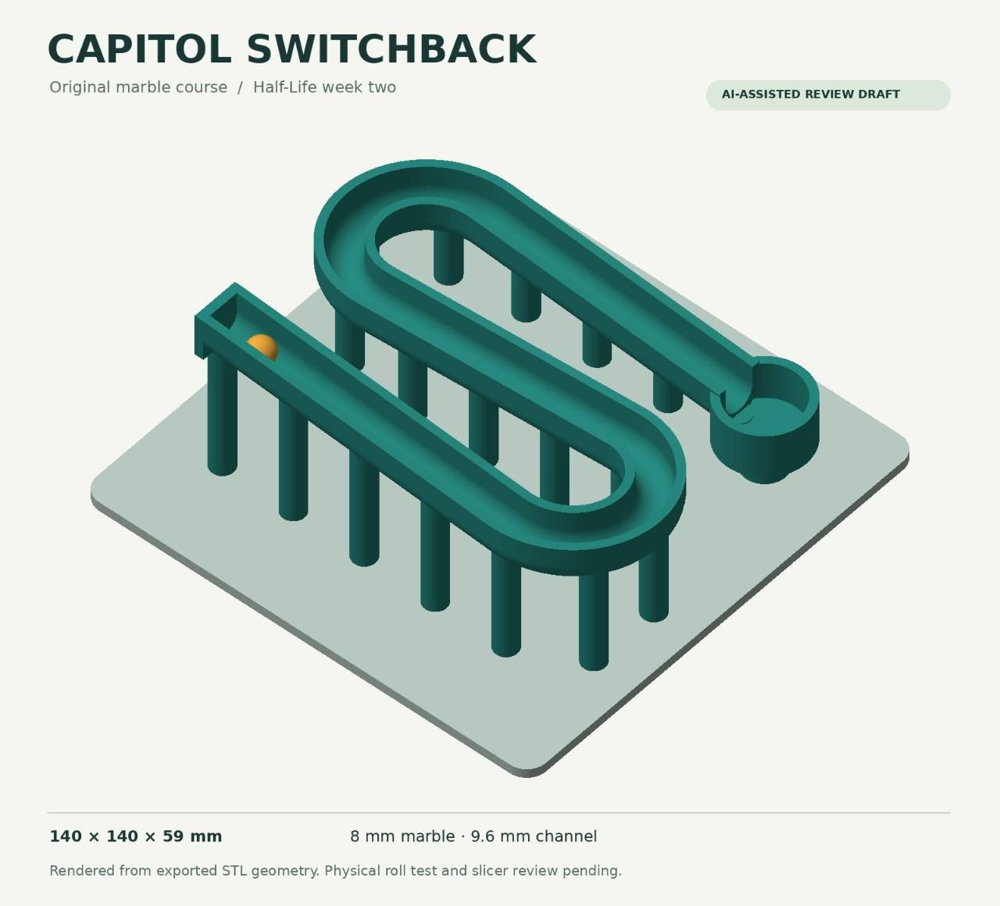

Owner-assigned day 1 image: Capitol Switchback concept, 140 × 140 × 59 mm, with an 8 mm marble and 9.6 mm channel.

## Tuesday, 2026-10-13 — Initial 3D model

Reported active time: **5 hours**.

Second day I started 3d modeling and built the basic design.

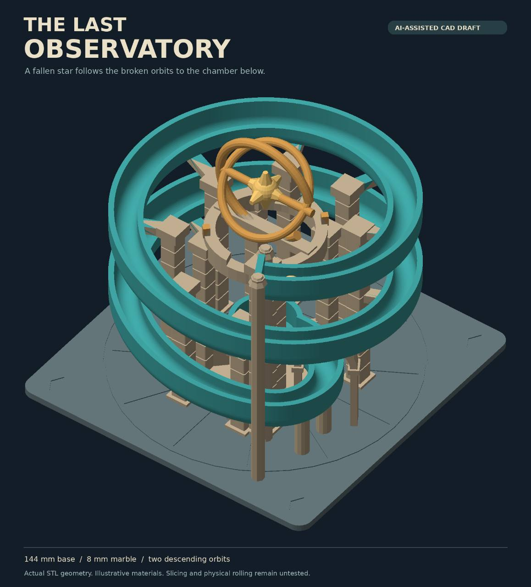

Owner-assigned day 2 design: The Last Observatory, with two descending orbits.

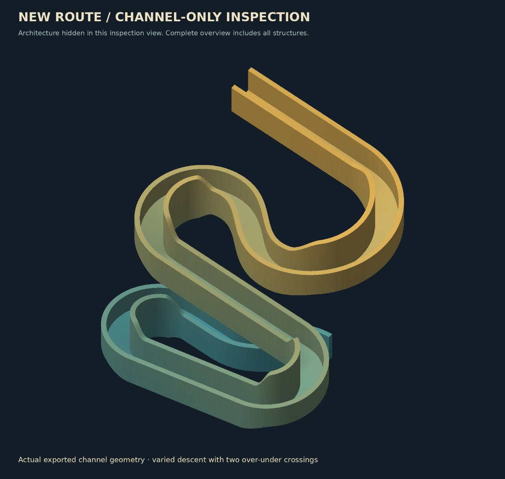

Owner-assigned day 2 design: channel-only inspection of the revised route.

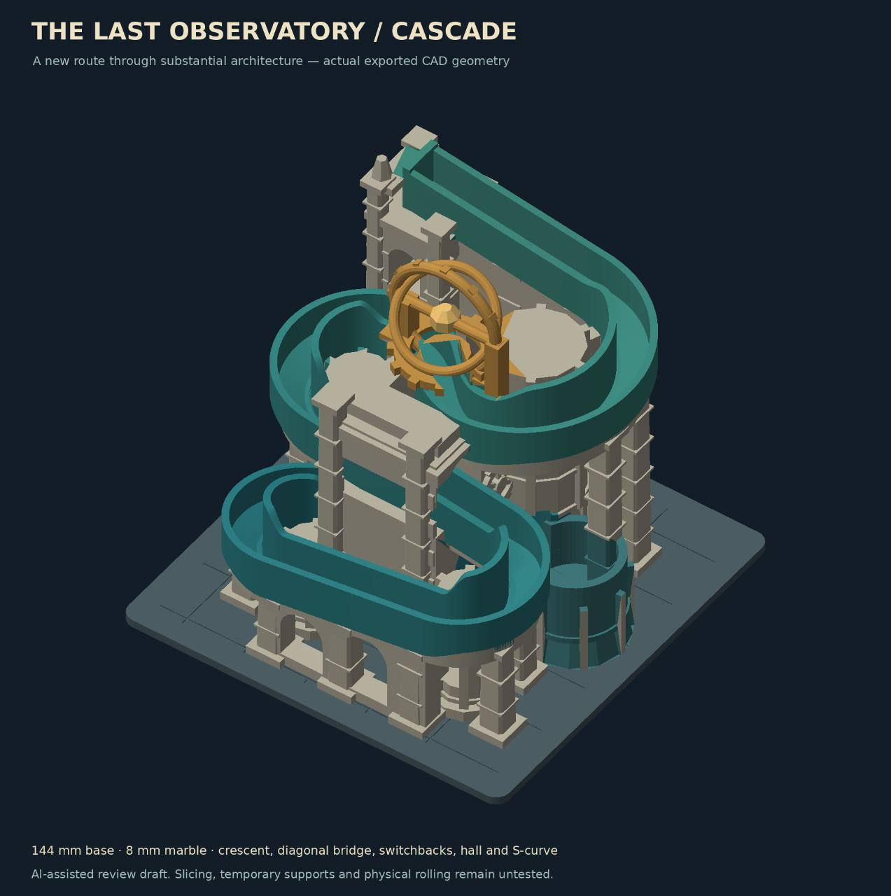

Owner-assigned day 2 design: the Cascade assembly and architecture.

## Wednesday, 2026-10-14 — Revising the design

Reported active time: **5 hours**.

3rd day I realized I didn't like what I made and made it more complicated with more things going on.

**Retrospective final-model references:** these show the final geometry and were added after the dated session.

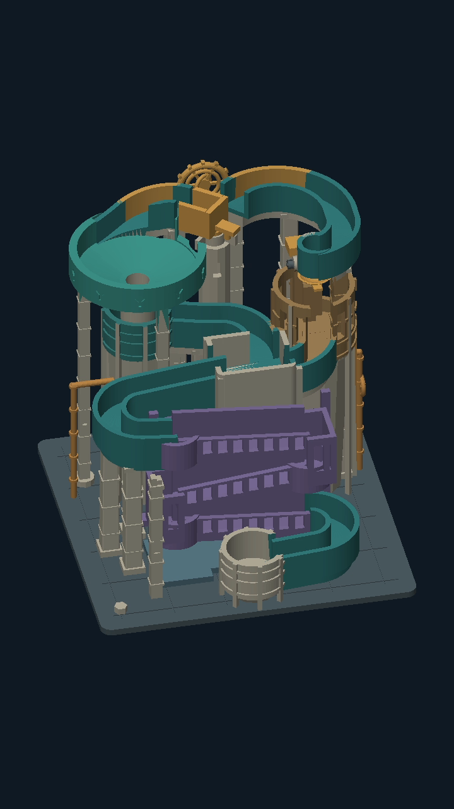

Final model overview

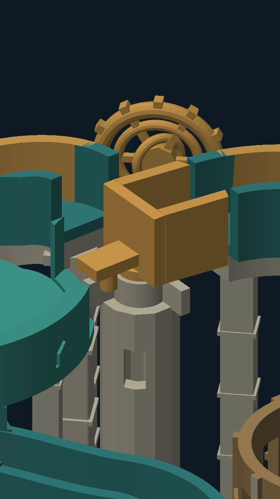

Final manual selector

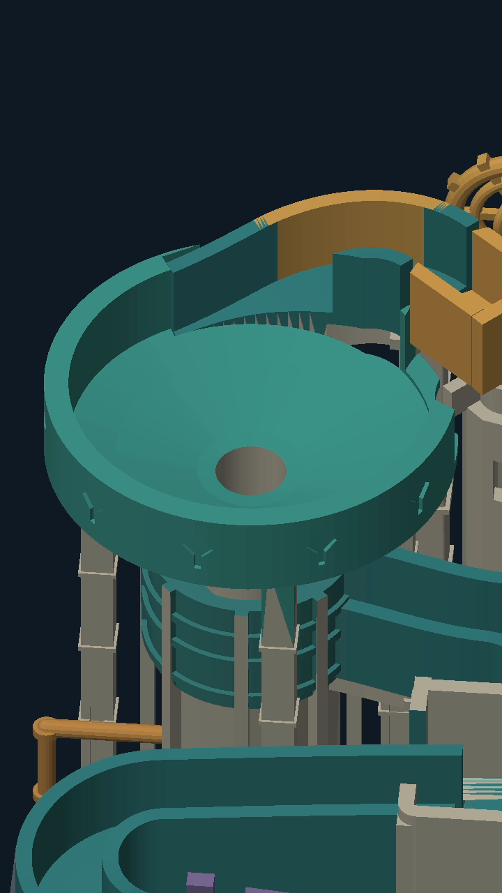

Final funnel

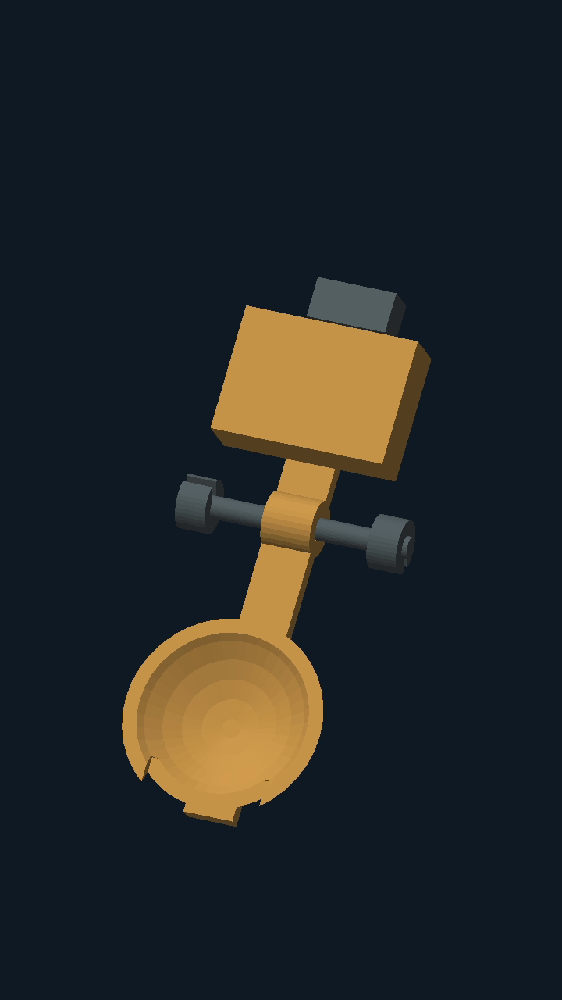

Final tipping cup

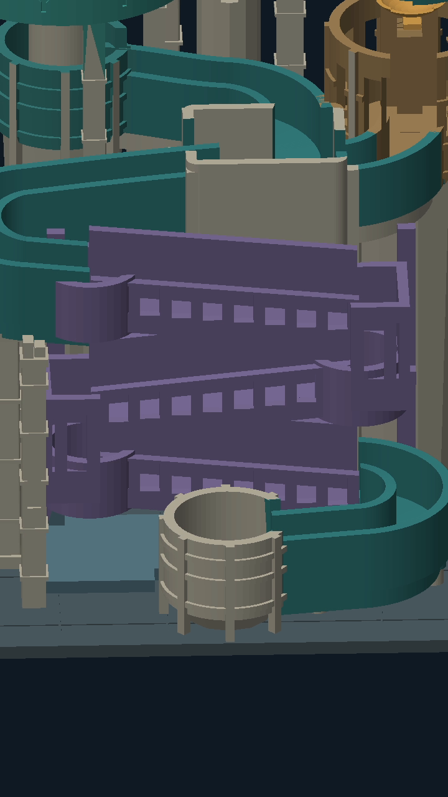

Final cascade and collector

## Thursday, 2026-10-15 — Finalizing the design

Reported active time: **5 hours**.

fourth day I finalized the design

And finished the stuff needed for the full submission.

**Retrospective final-model references:** these show the final geometry and were added after the dated session.

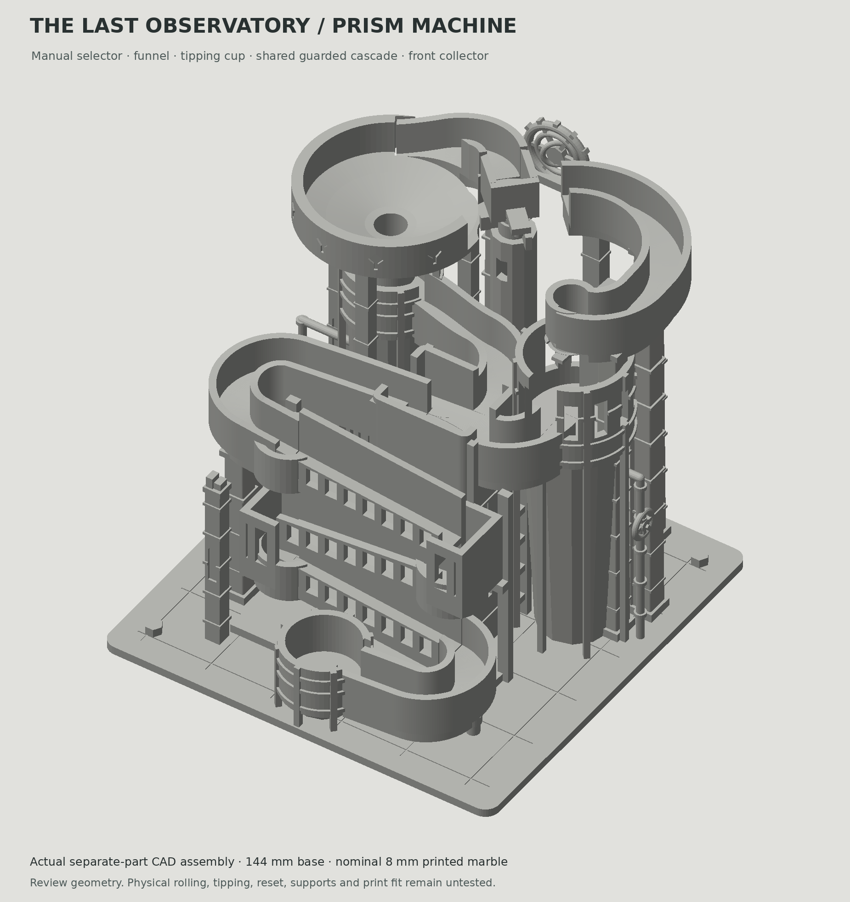

Final model in clay view

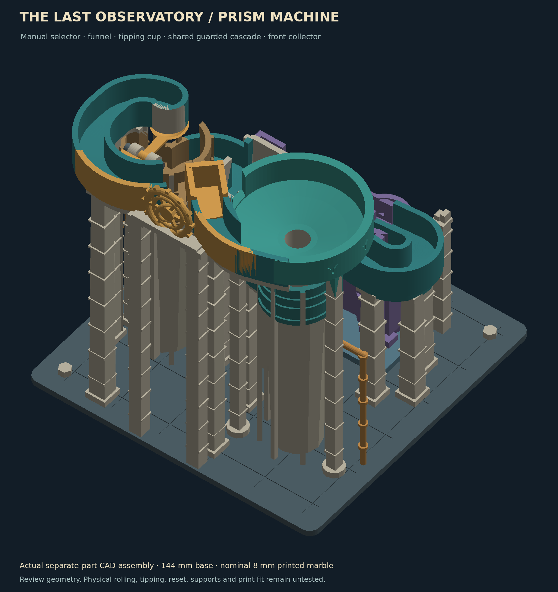

Final rear assembly

Final route plan

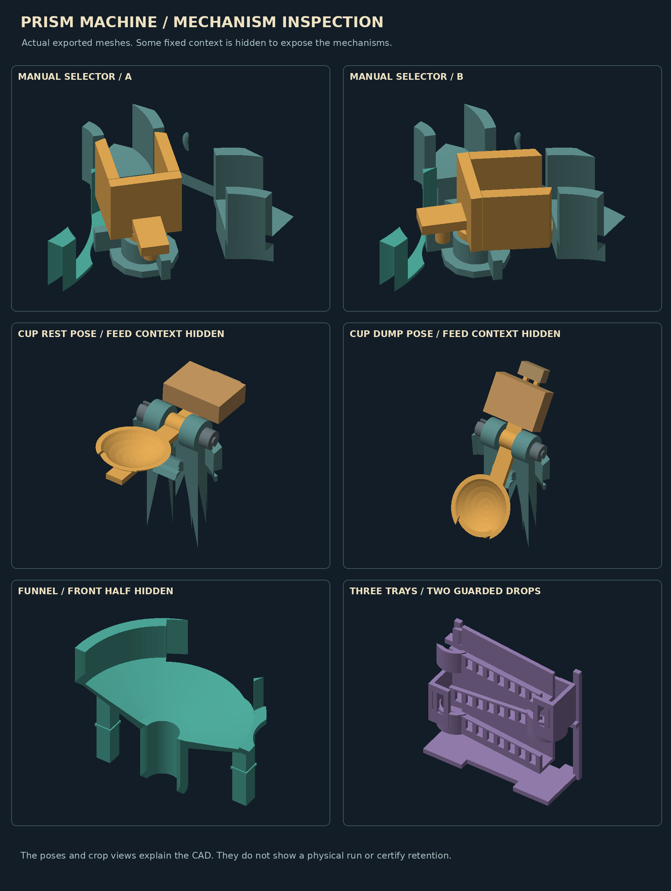

Final mechanism details

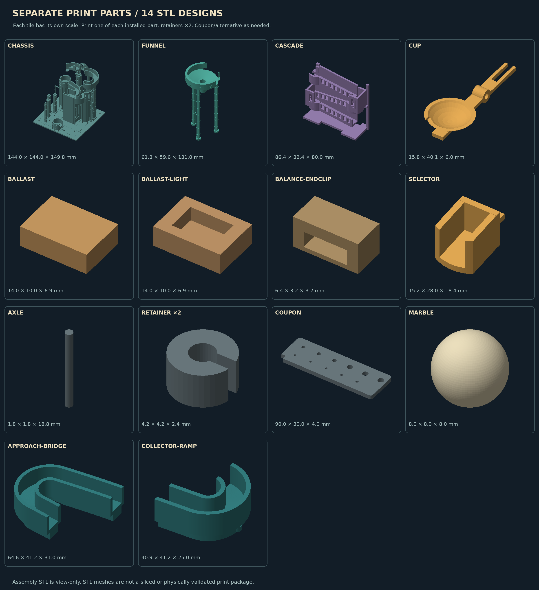

Final printable parts

## Available final-design images

The owner supplied four earlier-design images and assigned them to Monday and Tuesday. Additional final CAD views are available below. Image source and timing notes are recorded in [assets/journal/IMAGE-SOURCES.json](assets/journal/IMAGE-SOURCES.json).

- [Final assembly](assets/full-assembly.png)
- [Mechanism details](assets/mechanism-details.png)
- [Top plan](assets/top-plan.png)
- [Printable parts](assets/print-parts.png)

## Site status

At the last dashboard check, the idea reel must be posted before journaling unlocks. These notes have not been submitted as site entries.
