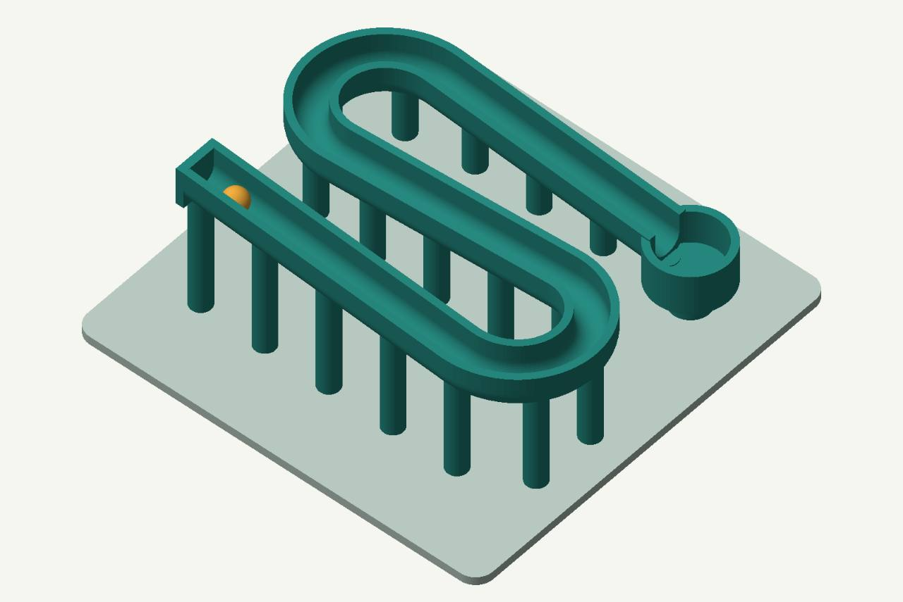
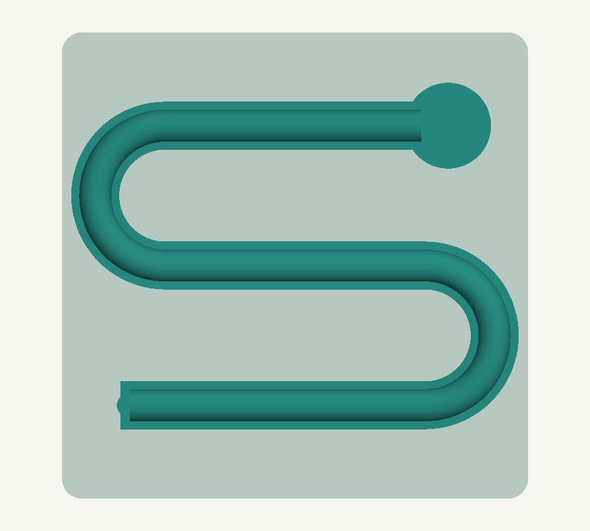
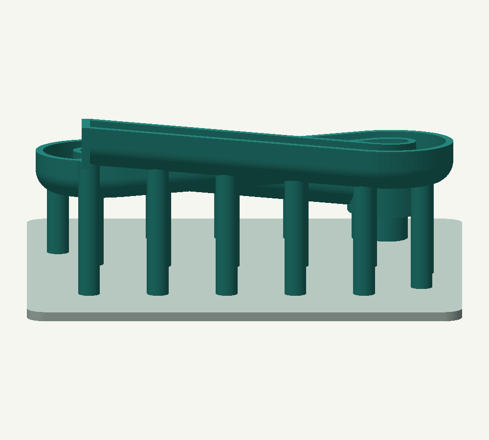
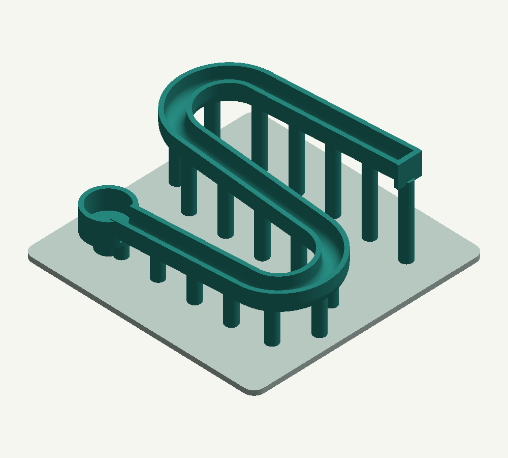
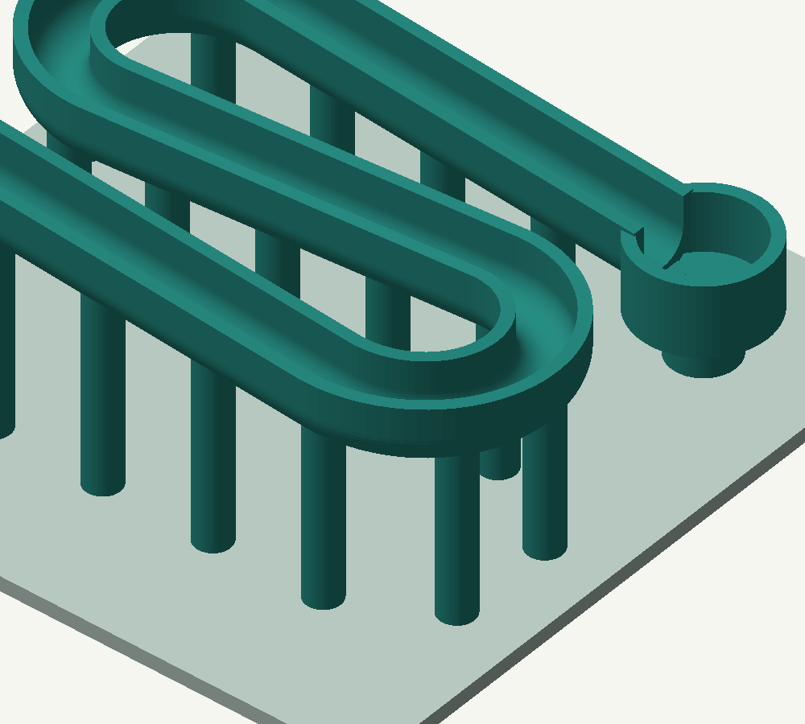
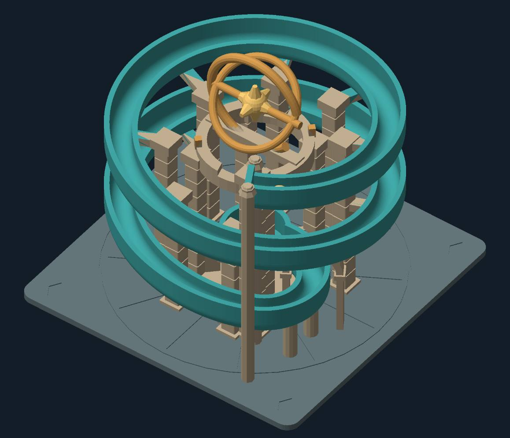
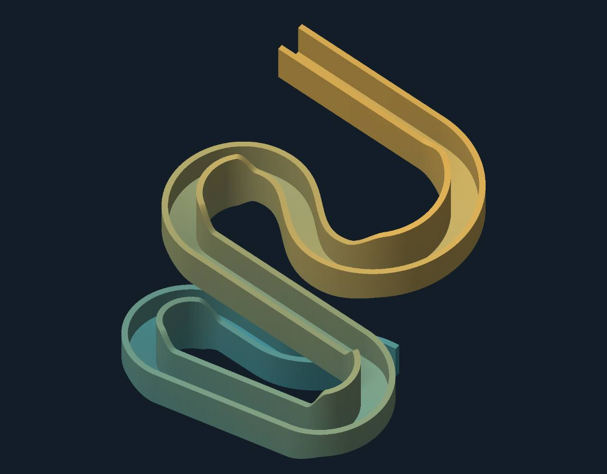
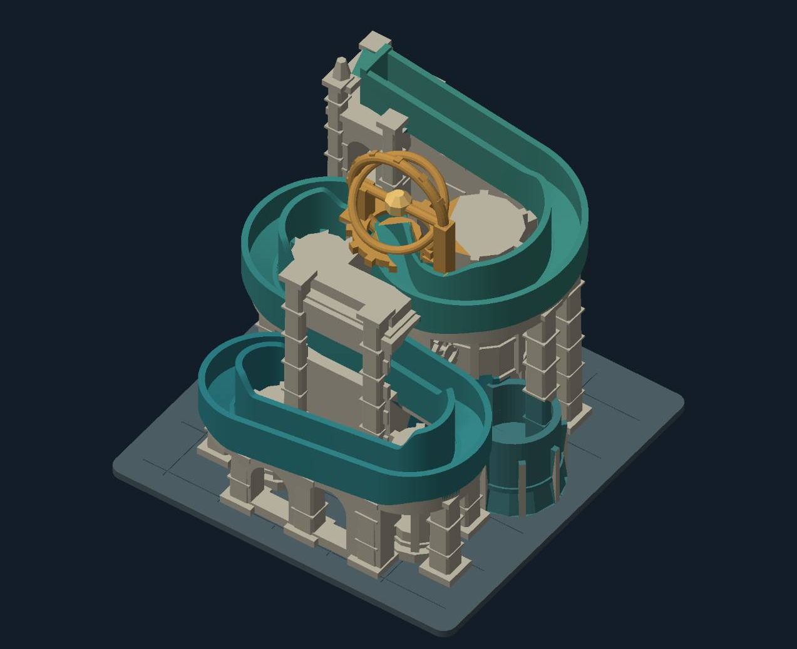
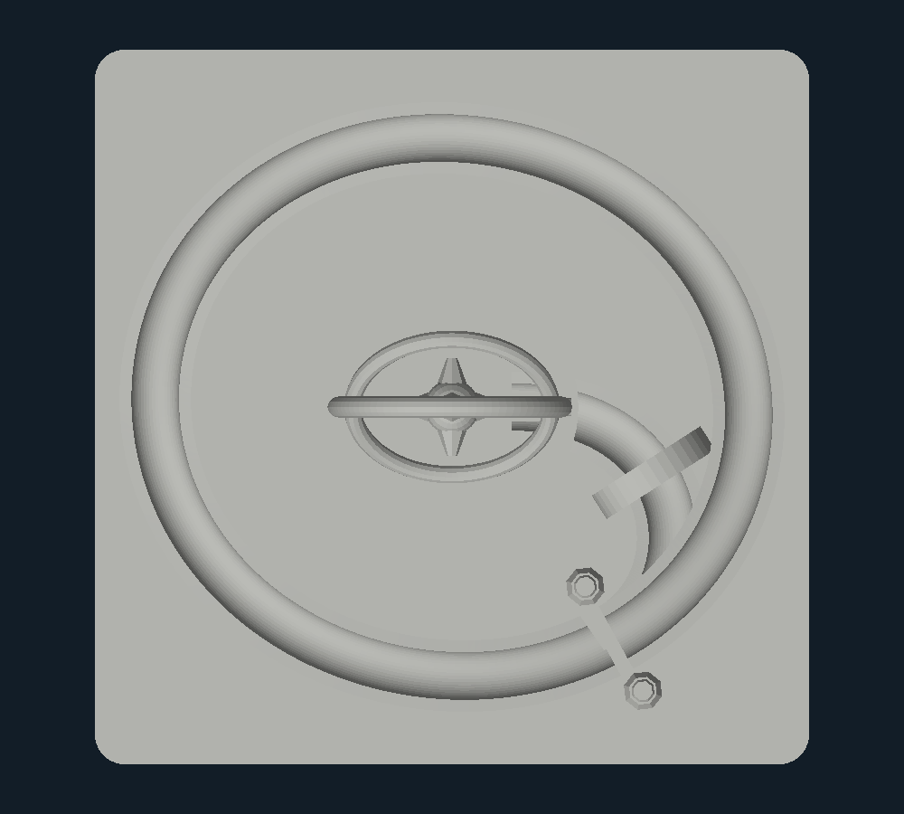
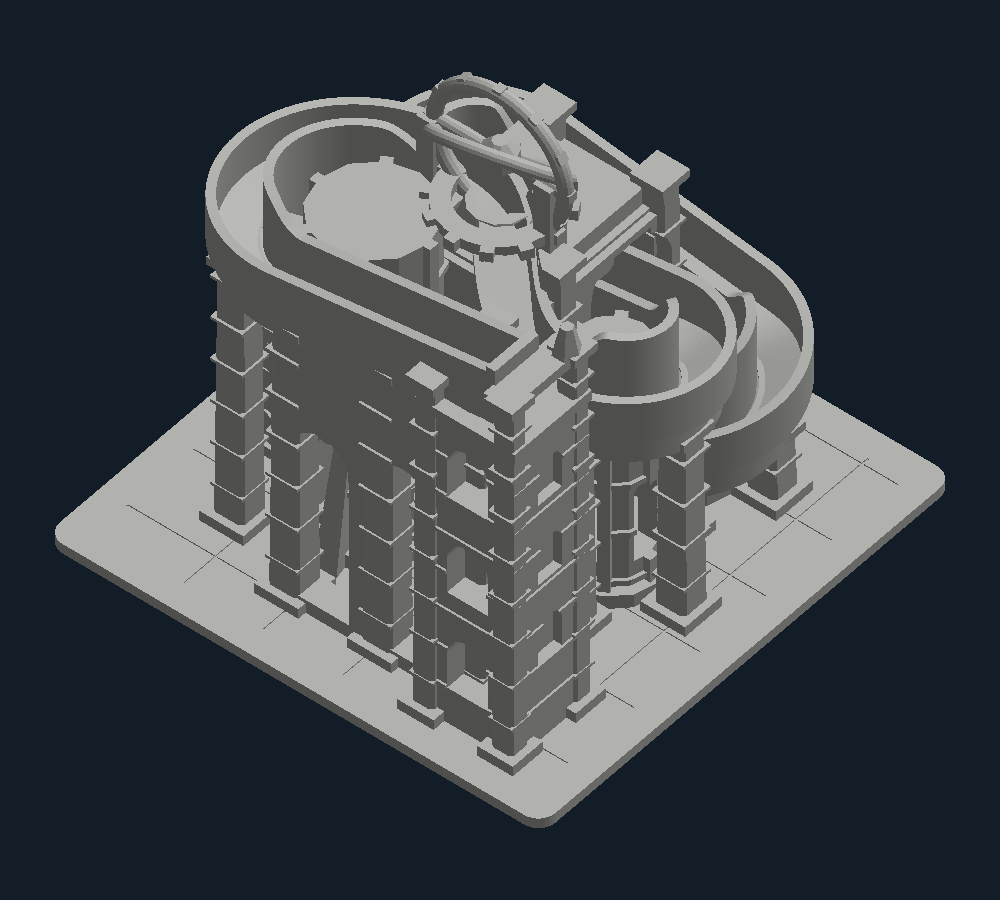

# Session notes — The Last Observatory / Prism Machine

Project owner’s own account, supplied October 18, 2026. Session descriptions below are transcribed from that account. Dates follow the reported Monday–Thursday schedule. Each session’s five hours is a retrospective estimate supplied by the project owner.

**Reported total: 20 active hours.**

The images are organized according to the owner’s day assignments. Wednesday and Thursday use final-model references added retrospectively. The owner supplied expanded entries on October 18; all four exceed the 200-character writing minimum. Each day now has five linked images. Six added views were rendered on October 18 from the matching saved early-design STL files. These are marked retrospective reference views and retain source-mesh hashes. Additional views of the final model do not establish the earlier session dates or hours.

## Monday, 2026-10-12 — Design planning

Reported active time: **5 hours**.

I worked on planning the marble machine and deciding what I wanted the project to do. My starting concept was a compact switchback course for an 8 mm marble, with bends and supports guiding its path downward. I focused on the overall layout and how to make the route interesting while keeping the design small enough to become a manageable 3D printing project.

Owner-assigned day 1 image: Capitol Switchback concept, 140 × 140 × 59 mm, with an 8 mm marble and 9.6 mm channel.

**Additional retrospective views of the saved design:** rendered on October 18 from the actual saved STL geometry.

Top plan of the saved Capitol Switchback design

Front elevation of the saved Capitol Switchback design

Rear view of the saved Capitol Switchback design

Detail view of the saved course bend and supports

## Tuesday, 2026-10-13 — Initial 3D model

Reported active time: **5 hours**.

I started 3D modeling and developed the basic structure of the marble run. I explored the observatory theme, including a version with two descending orbits and another with a cascade layout. I also worked with a view showing just the channels so I could focus on the marble’s route separately from the surrounding architecture. This gave me a clearer starting point for the next revision.

Owner-assigned day 2 design: The Last Observatory, with two descending orbits.

Owner-assigned day 2 design: channel-only inspection of the revised route.

Owner-assigned day 2 design: the Cascade assembly and architecture.

**Additional retrospective views of the saved design:** rendered on October 18 from the actual saved STL geometry.

Top plan of the saved orbital Observatory design

Rear view of the saved Cascade design

## Wednesday, 2026-10-14 — Revising the design

Reported active time: **5 hours**.

I realized I wasn’t happy with the earlier design and revised it to include more variety and more things happening along the marble’s path. The revised design developed into two selectable routes: a funnel and a tipping cup with an adjustable counterweight. These routes join before a shared cascade and collector. I wanted the model to have several distinct features while still feeling like one observatory-themed machine.

**Retrospective final-model references:** these show the final geometry and were added after the dated session.

Final model overview

Final manual selector

Final funnel

Final tipping cup

Final cascade and collector

## Thursday, 2026-10-15 — Finalizing the design

Reported active time: **5 hours**.

I finalized the CAD design and prepared the project materials for submission. This included organizing the editable model, individual printable parts, assembly documentation, project images, and materials list. The final design includes detachable track sections to help with assembly and access. I also documented the remaining work: physical printing, fit checks, and testing whether the marble travels reliably and the tipping cup resets.

**Retrospective final-model references:** these show the final geometry and were added after the dated session.

Final model in clay view

Final rear assembly

Final route plan

Final mechanism details

Final printable parts

Additional-view source records: [mesh paths, hashes and capture timing](assets/journal/ADDITIONAL-VIEW-SOURCES.json). Saved early design files and their original documentation are in [design-history/](design-history/).

## Image presentation

The four uploaded design images are displayed as model-only rectangular crops. Their retained pixels are unchanged. The uploaded originals are retained in a local input backup; the submission pack uses only the exact model crops. [Crop coordinates and verification](assets/journal/CROP-RECORD.json).

## Available final-design images

The owner supplied four earlier-design images and assigned them to Monday and Tuesday. Additional final CAD views are available below. Image source and timing notes are recorded in [assets/journal/IMAGE-SOURCES.json](assets/journal/IMAGE-SOURCES.json).

- [Final assembly](assets/full-assembly.png)
- [Mechanism details](assets/mechanism-details.png)
- [Top plan](assets/top-plan.png)
- [Printable parts](assets/print-parts.png)

## Site status

At the last dashboard check, the idea reel must be posted before journaling unlocks. These notes have not been submitted as site entries.
