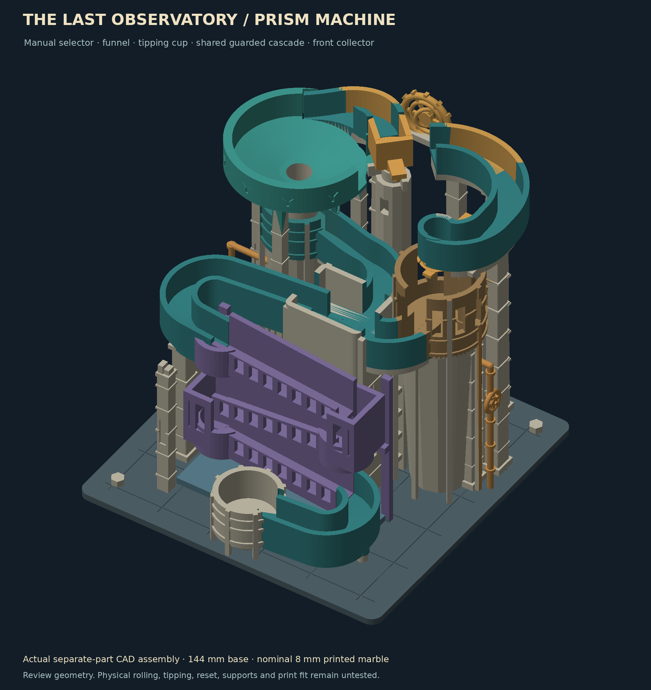
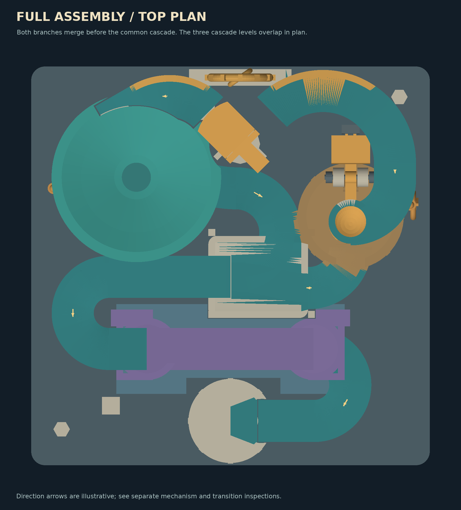

# Prism Observatory Marble Run

A gravity-fed marble-machine concept with two selectable routes, a shared cascade, and a ruined-observatory theme. The design uses a 144 mm square foundation and a nominal 8 mm printed marble.

**Project status:** CAD reference complete for inspection. The supplied revision passed its listed digital geometry screens. Physical printing, rolling, tipping, and automatic reset remain untested.

## How the marble run works

The manual selector at the top of the machine is positioned before feeding one marble. It chooses between two branches:

- **Funnel branch:** a tangential entrance feeds the bowl. The marble is intended to circle into the throat, drop into a sloped receiver, and continue toward the merge.
- **Tipping-cup branch:** a hopper feeds a pivoting cup. The cup is intended to tip under the loaded marble, release it into a deep receiver, and return after unloading. A sliding counterweight provides balance adjustment.

The branches rejoin at a shared approach rail. Three staggered trays and two guarded drops carry the route downward, followed by a detachable collector ramp and a front collector.

The cup's trigger, release, and reset behavior are design intentions pending physical tests. The machine has no supplied motorized lift or automatic recirculation system.

## Design approach

The layout combines three distinct marble-machine features within a compact footprint: a funnel, a balance-operated tipping cup, and a drop cascade. A manual selector makes each branch available separately, which also allows the two routes to be inspected and tested independently.

The approach bridge and collector ramp are detachable so the route can be accessed for assembly and maintenance. The cascade also has a defined removal path through the surrounding structure. Fixed scenery gives the model its observatory setting without introducing extra powered mechanisms.

Carved niches, stone-course details, a broken survey pillar, recessed funnel markings, gauges, and instrument sculpture are modeled geometry. The celestial instrument and gauges are fixed decorative features. Colors in the renders illustrate possible finishes; no multi-material toolpath is supplied.

## Dimensions and interfaces

| Feature | Reference value |
| --- | --- |
| Foundation footprint | 144 × 144 mm |
| Foundation thickness | 3 mm |
| Chassis total height | Approximately 149.8 mm |
| Printed marble | Nominal 8 mm diameter |
| Export units and intended print scale | Millimeters; 100% scale |
| Cup wall | 0.8 mm |
| Nominal axle | 1.75 mm diameter |
| Cup and mounting bores | 1.95 mm diameter |
| Selector stem / bore | 4.6 / 5.0 mm diameter |
| Module locating pins / bores | 3.0 / 3.4 mm diameter |

## Project files

The linked source and export files are included in this repository.

- [Main editable OpenSCAD model](model/cad/observatory-machine.scad)
- [Generated route data](model/cad/route-data.scad)
- [Cascade source](model/cad/drop-cascade.scad)
- [Tipping-mechanism source](model/cad/light-tipper.scad)
- [Detailed assembly and maintenance guide](model/ASSEMBLY-GUIDE.txt)
- [Final digital-validation summary](model/verification/final-validation-summary.json)

The validation summary records hashes for the delivered revision. Changes to the geometry or re-exported files require fresh checks before relying on those results. Additional inspection tools and detailed reports are in the original complete reference pack.

## Parts list

| Part | Quantity | Function |
| --- | ---: | --- |
| [Chassis](model/exports/chassis.stl) | 1 | Foundation, fixed routes, mounts, and scenery |
| [Funnel](model/exports/funnel.stl) | 1 | Branch-A bowl and outlet |
| [Cascade](model/exports/cascade.stl) | 1 | Three-tray drop section |
| [Approach bridge](model/exports/approach-bridge.stl) | 1 | Detachable shared approach rail |
| [Collector ramp](model/exports/collector-ramp.stl) | 1 | Detachable final rail |
| [Selector](model/exports/selector.stl) | 1 | Manual branch selection |
| [Cup](model/exports/cup.stl) | 1 | Pivoting branch-B cup |
| [Regular counterweight carrier](model/exports/ballast.stl) | 1 | Adjustable cup balance |
| [Balance endclip](model/exports/balance-endclip.stl) | 1 | Counterweight retention |
| [Axle](model/exports/axle.stl) | 1 | Cup pivot |
| [Retainer](model/exports/retainer.stl) | 2 | Axle retention |
| [Marble](model/exports/marble.stl) | 1 | Nominal 8 mm printed ball |
| [Fit coupon](model/exports/coupon.stl) | 1 initial test piece | Printer-specific fit checks |
| [Light counterweight carrier](model/exports/ballast-light.stl) | Optional replacement | Alternative for balance tuning |

Install one counterweight carrier, not both. These quantities describe the assembly and its test/alternative parts. The baseline purchased-material estimate is in [BOM.md](BOM.md). Slicer material consumption, shipping/tax totals, and print time still require confirmation.

## Opening the model

The source was prepared for **OpenSCAD 2021.01**. Open the main model with the supporting SCAD files kept in the same `model/cad/` directory. Assembly and part-selection settings are in the source.

The included STL files are individual part exports. Use those individual files for print preparation rather than treating an inspection assembly as one printable object.

The original reference pack's regeneration toolchain uses Python 3, NumPy, Pillow, and OpenSCAD. Its complete export, cleanup, and verification sequence is documented in the assembly guide; the tool scripts are included in `model/tools/`.

## Print preparation

The model is designed around millimeter units and 100% scale. The starting material assumption is PLA, with a solid printed marble and regular counterweight. The marble and moving parts must be weighed and measured before balance tuning.

1. Print the fit coupon first and test it with the actual axle and locating pins.
2. Inspect every part in a slicer. Confirm that the 0.8 mm cup wall is preserved.
3. Plan support removal before printing. Elevated rails, scenery, the cup hub, and selector stem need particular attention.
4. Keep support material out of channels, pivot bores, the selector bearing, and funnel throat.
5. Check marble roundness, seams, and surface finish. Inspect the moving cup for friction and rubbing.

No G-code or printer-specific slicer project is included. Support access, part strength, dimensional fit, and print duration still need verification on the intended printer.

## Assembly overview

Use the detailed guide for the exact installation offsets and coordinates. The main sequence is:

1. Remove supports and debris, inspect the parts, and test the fit coupon.
2. Install the cascade using its offset approach, rather than forcing it straight through surrounding geometry.
3. Align and lower the collector ramp onto its keyed supports.
4. Install the approach bridge while the funnel is still removed.
5. Seat the funnel and install the manual selector.
6. Fit the cup between its bearing posts, insert the axle, and add one retainer outside each post.
7. Install the selected counterweight carrier and endclip, then check free movement before feeding a marble.

The reference starts the counterweight center 9.7 mm behind the axle, with a digitally reviewed range of 9.5–10.5 mm. These are starting dimensions for physical tuning. Part mass and friction can change the required balance.

Service joints should remain accessible. Dry-fit parts and follow the reverse removal sequence for maintenance.

## Verification results

The supplied final report records passing digital geometry screens for its exact CAD/STL revision:

| Digital screen | Reported coverage |
| --- | ---: |
| Individual part meshes | 14 |
| Sampled cup poses | 60 |
| Sampled counterweight poses | 180 |
| Sampled selector poses | 90 |
| Sampled module installation/removal poses | 451 |
| Static marble-sphere probes | 2,344 |
| Stationary-component pairs | 10 |

These screens assess the documented geometric conditions at sampled positions, with exclusions for intentional contacts. Static sphere probes are not rolling trajectories, and geometric clearance does not prove bounce control, reliable retention, or real mechanism operation.

The balance estimate does not fully model axle friction, impacts, print variation, or wear. No physical print or run has been performed for this reference.

## Remaining work

- Validate slicer settings, support removal, and thin walls on the intended printer
- Measure printed part fit and marble roundness
- Test both selector positions and the funnel exit
- Tune cup loading, triggering, release, and empty return
- Test merge transitions, cascade drops, bounce, and collector delivery
- Record actual results and revise any geometry that stalls or loses the marble

Physical checks should use one marble at a time on a level surface. If a marble stalls or escapes, stop feeding and resolve the cause before continuing.

## Credits and references

The supplied CAD reference was generated with OpenAI Codex for Yonathan to review. Mechanism inspiration listed in the original assembly guide includes Woodgears marble-element/flip-flop material and Out Of Marbles funnel/bucket descriptions; those references informed concepts, with no downloaded commercial mechanism geometry used.

- [Official marble guide](https://github.com/karnxx/merbl/blob/main/guide.md#marble)
- [Half-Life submission requirements](https://halflife.hackclub.com/docs/submitting)
- [Half-Life journalling requirements](https://halflife.hackclub.com/docs/journalling)

Technical dimensions, part quantities, assembly details, and validation counts in this README are drawn from the supplied model's assembly guide and final-validation summary.

## Purchased bill of materials

See [BOM.md](BOM.md) for the vendor-priced baseline and the limits of that quote. The single-color baseline uses one spool of PLA to print the listed parts; rendered colors do not require multiple purchased colors. No parts have been ordered.

## Work-hour record

[Reported work hours](WORK-LOG.md) records the project owner’s retrospective estimates: five hours on each of October 12–15, 2026, totaling 20 hours. It is a timing record, not a completed personal journal.
